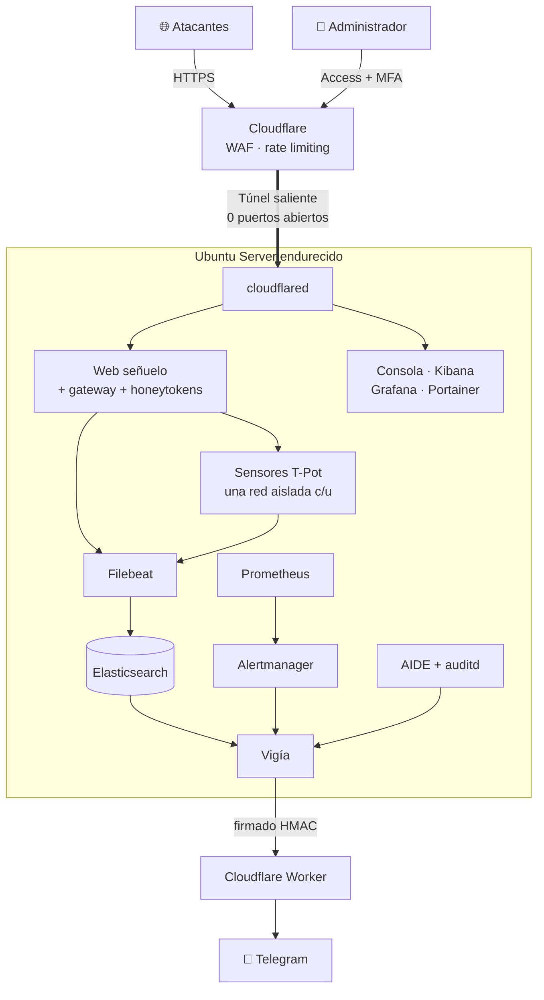

<div align="center">

# 🛡️ Centinela

### Honeypot endurecido, sin puertos abiertos, con SIEM, monitoreo y alertas en tiempo real

*Infraestructura como código (Ansible) que convierte un Ubuntu Server limpio en una plataforma de engaño
lista para producción, diseñada para vivir dentro de una red institucional sin ponerla en riesgo.*


[Qué es](#-qué-es) · [Resultados](#-resultados) · [Arquitectura](#️-arquitectura) · [Seguridad](#️-seguridad-en-profundidad) · [Instalación](#-instalación) · [Cómo se construyó](#-cómo-se-construyó)

</div>

---

## 🎯 Qué es

Un **honeypot** es un sistema señuelo: parece un objetivo real y vulnerable, pero su único propósito es atraer
atacantes para **observar qué hacen** (qué buscan, qué credenciales prueban, qué malware intentan instalar)
sin arriesgar nada real.

El reto de este proyecto no era instalar sensores, sino hacerlo **de forma segura dentro de la red de una
institución**: un honeypot mal configurado es exactamente la puerta de entrada que quiere un atacante.
Centinela resuelve eso con cuatro ideas:

| | Principio | Cómo se logra |
|---|---|---|
| 🚪 | **Cero puertos de entrada** | Todo el tráfico llega por un túnel *saliente* de Cloudflare. Un `nmap` al servidor no ve nada abierto. |
| 🧱 | **Si cae un sensor, el atacante queda encerrado** | Contenedores sin root, sin capacidades, solo lectura, con `userns-remap` y en redes sin salida. |
| 🔐 | **Acceso administrativo de confianza cero** | Cloudflare Access + identidad + MFA obligatoria + validación del token en el origen. |
| 👁️ | **Todo se ve y todo avisa** | SIEM con clasificación automática de ataques, métricas, control de integridad y bot de Telegram. |

## 📊 Resultados

Medidos en un despliegue real en un servidor físico (12 núcleos, 16 GB):

| Métrica | Valor |
|---|---|
| Índice de hardening Lynis | **56 → 90** |
| Puertos de entrada visibles desde internet | **0** |
| Contenedores privilegiados / con puertos publicados | **0 / 0** |
| Hallazgos del pentest propio corregidos | **11 de 13** (los otros 2 no aplican o son decisiones de diseño) |
| Reglas de alerta (salud, ataques, integridad) | **36** en Prometheus + alertas de seguridad del SIEM |
| Reglas de auditoría del kernel (auditd) | **61** |
| Recuperación tras un corte de energía | **Automática, ~4 minutos** |
| Reconstruir el servidor desde cero | **Un comando**: `ansible-playbook site.yml` |

## ✨ Funcionalidades

<table>
<tr><td width="50%" valign="top">

**🔒 Hardening del host**
- 16 roles de Ansible idempotentes y etiquetados
- Kernel: sysctl endurecido, módulos bloqueados
- SSH: solo llave, puerto aleatorio, sin root, `AllowGroups`
- **Port knocking** de 5 toques TCP/UDP para emergencias
- PAM, faillock, pwquality, AppArmor, USBGuard
- Actualizaciones de seguridad automáticas, sin reinicios sorpresa

</td><td width="50%" valign="top">

**🐳 Contenedores y red**
- `userns-remap`, `no-new-privileges`, `cap_drop: ALL`
- Sistemas de archivos de solo lectura y usuarios no-root
- Límites de memoria, CPU y procesos en cada contenedor
- 6 redes segmentadas + **1 red aislada por sensor**
- **Egress denegado por defecto**: nada sale hacia redes privadas

</td></tr>
<tr><td valign="top">

**🍯 Engaño**
- Web corporativa falsa con marca configurable
- Gateway que enruta a sensores de **T-Pot**: WordPress, Log4Shell, Citrix, APIs, CVEs
- Trampas para `.env`, `.git`, phpMyAdmin, Actuator, backups…
- **Honeytokens** únicos por instalación: usarlos = alerta crítica

</td><td valign="top">

**📈 Detección y respuesta**
- **Elasticsearch + Kibana** con TLS, GeoIP y clasificación MITRE/CVE
- **Prometheus + Grafana + Alertmanager**
- **AIDE + auditd**: distingue cambios legítimos (apt, Ansible, Docker) de los hechos a mano
- **Bot de Telegram** con resumen, explicación de cada ataque y descarga segura de malware

</td></tr>
</table>

## 🏗️ Arquitectura



**Flujo de un ataque:** el atacante pide `blog.<dominio>/wp-login.php` → Cloudflare lo envía por el túnel →
el gateway lo reenvía a un WordPress falso aislado → la petición queda registrada con IP, país, credenciales
probadas y técnica MITRE → si es grave, llega una alerta a Telegram explicando qué intentó.

Detalle completo: **[docs/arquitectura.md](docs/arquitectura.md)**

## 🛡️ Seguridad en profundidad

| Si el atacante… | …se encuentra con |
|---|---|
| escanea el servidor | ningún puerto abierto; SSH solo existe 5 min para quien hace el knocking correcto |
| compromete un sensor | un contenedor sin root ni capacidades, de solo lectura y sin red de salida |
| intenta saltar a la red interna | reglas `DOCKER-USER` que bloquean todas las redes privadas y el rango de la institución |
| roba una contraseña del admin | MFA obligatoria y un JWT validado en el propio servidor |
| logra persistencia en el host | auditd + AIDE cada hora con alerta crítica en Telegram |
| usa las "credenciales filtradas" del señuelo | una alerta crítica inmediata: eran honeytokens |

Modelo de amenazas, controles y **riesgos residuales** (incluidos los que no se pueden eliminar):
**[docs/seguridad.md](docs/seguridad.md)**

## 🚀 Instalación

```bash
git clone https://github.com/diriartev/centinela.git && cd centinela
cp config.example.env config.env && nano config.env   # dominio e IDs de Cloudflare
nano hardening-ubuntu/inventory.ini                   # IP y usuario del servidor
python3 scripts/inicializar-secretos.py               # contraseñas, puerto SSH y knocking aleatorios
python3 scripts/regenerar-honeytokens.py              # honeytokens únicos
# configurar Cloudflare (túnel, Access, tokens) → ver la guía
source config.env && cd hardening-ubuntu && ansible-playbook site.yml
```

📘 **[Guía paso a paso](docs/instalacion.md)**: cada paso explica *qué hace*, *por qué* y *cómo comprobar que
funcionó*, desde un servidor vacío hasta recibir el primer ataque en Telegram.

| Documento | Contenido |
|---|---|
| [Guía de instalación](docs/instalacion.md) | De cero a producción, con verificaciones |
| [Arquitectura](docs/arquitectura.md) | Componentes, redes, flujo de datos, arranque |
| [Seguridad](docs/seguridad.md) | Amenazas, controles, pruebas y riesgos residuales |
| [Operación](docs/operacion.md) | Accesos, alertas, rotación, backups, incidentes |

## 📁 Estructura

```
centinela/
├── hardening-ubuntu/            Playbook principal (site.yml) y configuración
│   ├── group_vars/all/main.yml  Toda la configuración no secreta, comentada
│   └── roles/
│       ├── base · kernel · autenticacion · ssh · firewall · auditoria   → hardening del host
│       ├── docker · portainer · edge                                    → contenedores y túnel
│       ├── decoy · honeypots                                            → señuelo y sensores
│       └── siem · panel · cfmetrics · monitoreo · vigia                 → datos, paneles y alertas
├── scripts/                     Secretos, accesos, rotación, backups, Lynis, docker-bench
├── knocking/knock.py            Cliente de port knocking (Linux, macOS, Windows)
├── cloudflare/worker-hooks/     Worker: relay de alertas y bot de Telegram
└── docs/                        Documentación
```

## 🧰 Stack

| Área | Tecnologías |
|---|---|
| Infraestructura | Ubuntu Server · Ansible · Docker / Compose · LVM · UFW · knockd |
| Seguridad del host | auditd · AIDE · AppArmor · USBGuard · Lynis · docker-bench-security |
| Engaño | T-Pot (Wordpot, Log4Pot, CitrixHoneypot, Honeyaml, h0neytr4p, Cowrie, Dionaea…) · web señuelo propia en Python |
| Datos y monitoreo | Elasticsearch · Kibana · Filebeat · Prometheus · Alertmanager · Grafana |
| Borde e identidad | Cloudflare Tunnel · Access (Zero Trust) · WAF · Workers · Auth0 (MFA) |
| Lenguajes | YAML / Jinja2 · Python · Bash · JavaScript |

## 🤖 Cómo se construyó

Este proyecto lo diseñé, desplegué y opero yo, y lo desarrollé **trabajando en pareja con IA**
(Claude Code, de Anthropic) como compañero de trabajo, como se hace hoy en muchos equipos de ingeniería:

- **Mi parte:** definir los requisitos y las restricciones (no exponer la red de la institución, cero puertos,
  ningún secreto en disco ni en el repositorio), tomar las decisiones de arquitectura y seguridad, desplegar y
  operar el servidor real, probar cada componente, hacer el pentest y decidir qué se corregía y cómo.
- **La parte de la IA:** acelerar la escritura de roles, scripts y documentación, proponer alternativas,
  revisar configuraciones y ayudar a depurar los problemas que aparecieron en producción.

Todo lo que está aquí se ejecutó y validó en un servidor físico real.

## 🗺️ Próximos pasos

- [ ] Copia de la línea base de AIDE fuera del servidor (inmutable)
- [ ] Separar más la red de administración (panel, Kibana y Portainer en redes distintas)
- [ ] Sensores de red (SSH, SMB, ICS) expuestos mediante un VPS y WireGuard, sin abrir puertos en la red interna

## ⚠️ Uso responsable

Un honeypot atrae tráfico malicioso a propósito. Despliégalo solo en infraestructura propia o con
autorización escrita de quien la administra, y cumple la normativa de protección de datos de tu país.
Las vulnerabilidades del proyecto se reportan según [SECURITY.md](SECURITY.md).

---

<details>
<summary><b>🇬🇧 English summary</b></summary>

**Centinela** is an Ansible-based infrastructure-as-code project that turns a fresh Ubuntu Server into a
production-ready, hardened honeypot platform designed to run inside an institutional network without
putting it at risk. It exposes **zero inbound ports** (everything goes through an outbound Cloudflare Tunnel),
isolates every sensor in its own egress-less Docker network with `userns-remap`, `cap_drop: ALL` and
read-only filesystems, protects admin access with Cloudflare Access + MFA, and provides an Elastic SIEM with
automatic MITRE/CVE classification, Prometheus/Grafana monitoring, AIDE + auditd integrity checks and real-time
Telegram alerts. Results on real hardware: Lynis score 56 → 90, 0 privileged containers, 11/13 pentest
findings fixed, automatic recovery after a power loss in ~4 minutes. Designed, deployed and operated by me,
built with an AI pair-programmer (Claude Code) as a coworker.

</details>

<div align="center">

**Daniel José Iriarte Vargas** · [@diriartev](https://github.com/diriartev) · Licencia [MIT](LICENSE)

</div>
