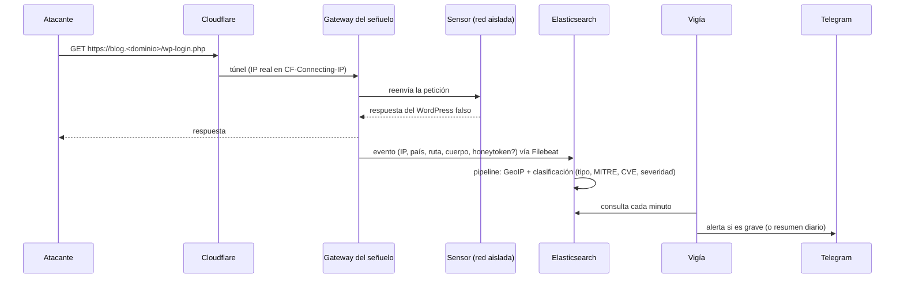

# Arquitectura

## Principios

1. **Nada entra; todo sale.** El servidor no publica puertos. `cloudflared` abre una conexión *saliente* hacia
   Cloudflare y por ahí llega todo el tráfico, tanto el de los atacantes (al señuelo) como el del administrador
   (a las consolas, detrás de Access).
2. **Segmentación estricta.** Cada función vive en su red Docker; cada sensor web en una red propia que solo
   comparte con el gateway. Las redes de sensores son `internal` (sin salida).
3. **Egress denegado por defecto.** En `DOCKER-USER` se bloquea todo lo que sale de los contenedores hacia
   redes privadas, CGNAT, link-local y la red pública de la propia institución. A internet solo salen
   `cloudflared`, el colector de métricas y el vigía, y solo hacia los rangos de Cloudflare.
4. **Mínimo privilegio en todo.** Contenedores sin root, sin capacidades, de solo lectura y con `userns-remap`;
   usuarios de Elastic con un rol por servicio; Kibana de solo lectura para quien entra por Access.
5. **Todo es código.** El servidor completo se reconstruye con `ansible-playbook site.yml`.

## Componentes

| Capa | Componente | Red(es) | Expuesto como |
|---|---|---|---|
| Borde | `cloudflared` | edge, admin, dmz, mon | — (sale a Cloudflare) |
| Señuelo | `hp-web` (web falsa + gateway + honeytokens) | dmz + una red por sensor | apex, `www` |
| Sensores web | Wordpot · Honeyaml · CitrixHoneypot · Log4Pot · h0neytr4p | `sensor-*` (internas) | `blog` · `api` · `vpn` · `sso` · rutas CVE |
| Sensores de red | Cowrie · Dionaea · Conpot · Redis · Elasticpot · ADBHoney · Mailoney | honey (interna) | No expuestos por defecto |
| Datos | Elasticsearch · Filebeat | data | — |
| Consolas | Panel (`console.`) · Kibana (`insights.`) · Portainer (`ops.`) · Grafana (`metrics.`) | admin / mon | Access + MFA |
| Monitoreo | Prometheus · Alertmanager · node-exporter | mon | — |
| Alertas | Vigía → Worker de Cloudflare → Telegram | data, edge | `hooks.` (firmado con HMAC) |
| Host | auditd · AIDE · knockd · UFW · USBGuard · AppArmor | — | SSH solo por túnel o knocking |

## Flujo de un ataque

## Redes

| Red | Rango (por defecto) | Interna | Quién |
|---|---|---|---|
| edge | 10.213.250.0/24 | no | cloudflared, cfmetrics, vigía (únicos con salida) |
| admin | 10.213.251.0/24 | sí | consolas |
| data | 10.213.252.0/24 | sí | Elasticsearch, Filebeat, panel, vigía |
| honey | 10.213.253.0/24 | sí | sensores de red |
| dmz | 10.213.254.0/24 | sí | señuelo + cloudflared |
| mon | 10.213.248.0/24 | sí | Prometheus, Alertmanager, Grafana |
| sensor-* | 10.213.240.0/29 c/u | sí | un sensor + el gateway |

## Arranque y recuperación

- `docker`, `containerd`, `auditd`, `knockd`, `ssh` y los timers están habilitados en systemd; todos los
  contenedores usan `restart: unless-stopped`. Tras un corte de luz todo vuelve solo (medido: ~4 minutos).
- Las reglas de auditd que dependen de archivos que aún no existen al arrancar se cargan después
  (`auditctl -i` + un *drop-in* de containerd), para no perder reglas en el arranque.
- Los despliegues de Ansible pausan la revisión de integridad y, al terminar, aceptan sus propios cambios en la
  línea base de AIDE: solo los cambios **no explicados** generan alerta.
